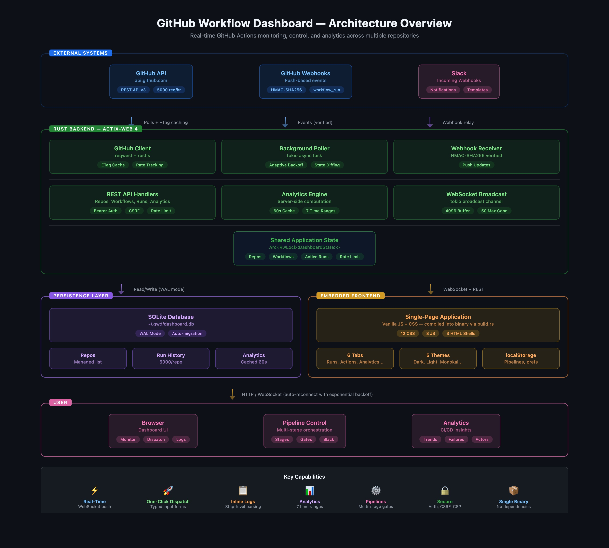

# GitHub Workflow Dashboard (GWD)

**A Real-Time GitHub Actions Monitoring & Control Centre**

---

## What Is It?

GitHub Workflow Dashboard is a self-hosted, single-binary web application that provides a unified view of GitHub Actions across all your repositories. Instead of opening dozens of browser tabs to monitor CI/CD pipelines, GWD consolidates everything into one real-time dashboard with live status updates, inline logs, workflow dispatch, pipeline orchestration, and analytics.

It is built with Rust for performance and reliability, and ships as a single executable with the entire frontend embedded — no Node.js, no npm, no external dependencies.

---

## The Problem: Why This Exists

### GitHub Actions Monitoring Is Fragmented

Teams working across multiple repositories face daily friction when using GitHub's native Actions UI:

| Pain Point | Impact |
|---|---|
| **Tab sprawl** | Developers open separate tabs per repo to check workflow status; context-switching kills productivity |
| **No cross-repo view** | There is no native GitHub feature to see all workflows across repos on a single screen |
| **Manual refresh** | The GitHub Actions page requires manual page reloads to see updated run status |
| **Hidden logs** | Viewing job logs requires multiple clicks into each run, each job, then each step |
| **No pipeline orchestration** | GitHub Actions has no built-in concept of multi-repo, multi-stage pipelines with approval gates |
| **No persistent analytics** | GitHub provides run history per-repo, but no aggregated success rates, duration trends, or failure analysis |
| **API rate limits** | Programmatic monitoring risks exhausting the 5,000 requests/hour GitHub API quota without careful management |
| **No unified dispatch** | Triggering `workflow_dispatch` workflows requires navigating to each repo individually |

### The Cost of These Gaps

- **Wasted developer time** — Engineers spend minutes per day just checking "did my pipeline pass?" across repos
- **Delayed incident response** — Failures in shared pipelines go unnoticed until someone happens to check
- **No visibility for managers** — No easy way to see overall CI/CD health, trends, or bottleneck workflows
- **Inefficient release coordination** — Multi-repo releases require manual sequencing with no tooling support

---

## How GWD Solves This

### Single Pane of Glass

Add up to 50 repositories and see every workflow, every run, and every status in one dashboard. Filter by repo in the sidebar, search workflows by name, and click into any run for details — all without leaving the page.

### Real-Time Updates via WebSocket

No more manual refreshing. GWD maintains a persistent WebSocket connection to your browser. When a workflow starts, completes, or fails, your dashboard updates instantly. The backend also supports GitHub webhooks for push-based updates with HMAC-SHA256 verification.

### Adaptive Rate Limit Management

GWD intelligently manages your GitHub API quota:

- **Normal mode** (>100 requests remaining) — polls at the configured interval
- **Conservation mode** (10–100 remaining) — gradually increases backoff using exponential scaling
- **Critical mode** (<10 remaining) — skips polling entirely until quota resets

A live rate-limit badge in the dashboard header shows remaining/total requests with colour-coded status so you always know where you stand.

### Inline Job Logs

Click any run to view its job logs directly in a split-panel at the bottom of the dashboard. Logs are parsed at the step level, with ANSI escape codes stripped for clean display. No more clicking through GitHub's nested UI to find the failing step.

### One-Click Workflow Dispatch

The **Actions** tab shows all `workflow_dispatch`-enabled workflows as cards. Click one, and GWD auto-discovers the workflow's input schema — string fields, boolean toggles, dropdown choices, number inputs, environment selectors — and presents a typed form. Select a branch, fill in inputs, and trigger the workflow without ever opening GitHub.

### Pipeline Orchestration

GWD introduces a concept that GitHub Actions lacks natively: **cross-repo, multi-stage pipelines with approval gates**.

- Create named pipeline tabs (e.g., "Production Release", "Nightly Integration")
- Define numbered stages; assign workflows from any monitored repo to each stage
- Workflows within a stage run in parallel; stages execute sequentially
- Inter-stage gates prompt for manual approval before proceeding
- A variables sidebar lets you set the branch and override per-workflow inputs
- Export/import pipeline configurations as JSON for sharing with the team
- Slack notifications at configurable trigger points (before/after stages)

### Server-Side Analytics

The **Analytics** tab provides computed metrics with configurable time ranges (1 hour to 30 days):

| Metric | What It Shows |
|---|---|
| **Success Rate** | Overall pass rate with per-repo and per-workflow breakdowns |
| **Duration Analysis** | Average/median build times, trend detection, slowest runs |
| **Trigger Breakdown** | Distribution by event type (push, PR, dispatch, schedule) with success rates |
| **Actor Leaderboard** | Top contributors by run count with inline success indicators |
| **Branch Activity** | Most active branches with stacked success/failure charts |
| **Failure Analysis** | Most failing workflows, failure streak detection, recent failures list |

All analytics are backed by SQLite persistence, so historical data survives server restarts and accumulates over time.

### Slack Integration

Built-in Slack webhook integration with a template library:

- Create reusable message templates with `{{variable}}` substitution (repo name, branch, stage)
- Manage multiple Slack webhook URLs
- Attach notifications to pipeline stages (before first stage, after each stage, after final stage)
- Templates are managed directly from the dashboard UI

---

## Feature Summary

### Monitoring & Visibility

- 6 dashboard tabs: Active Runs, Workflows, Actions, History, What's Happening, Analytics
- Real-time WebSocket updates with auto-reconnect
- GitHub webhook receiver for push-based updates
- Live rate-limit badge with colour-coded status
- Per-repo sidebar filtering with search
- Collapsible workflow groups with alternating colours

### Workflow Control

- One-click workflow dispatch with auto-discovered typed input forms
- Cancel in-progress workflows
- Re-run completed workflows
- Branch selector with smart sorting (main/master/develop prioritised)

### Pipeline Orchestration

- Custom pipeline tabs with named, numbered stages
- Cross-repo workflow assignment
- Sequential stage execution with parallel intra-stage runs
- Manual approval gates between stages
- Variables sidebar for branch and input overrides
- JSON export/import for sharing configurations

### Logs & Diagnostics

- Inline split-panel log viewer
- Step-level log extraction with per-step view buttons
- ANSI escape code stripping
- Full-screen modal option
- Client-side log caching

### Analytics & Reporting

- 7 configurable time ranges
- Success rate, duration, trigger, actor, branch, and failure analysis
- Per-repo and per-workflow drill-down
- SQLite-backed persistent history

### Integrations

- Slack webhook notifications with template library
- GitHub webhook receiver (HMAC-SHA256 verified)

### User Experience

- 5 built-in themes (Terminal Dark, Light, Monokai, Solarized Dark, Midnight Blue)
- Animated startup splash with connection progress
- Resizable panels with localStorage persistence
- Keyboard-accessible with focus-visible indicators
- Smooth tab transitions

---

## How It Saves Time

| Scenario | Without GWD | With GWD |
|---|---|---|
| **Check pipeline status across 10 repos** | Open 10 tabs, navigate to Actions in each, manually refresh | Glance at one dashboard, filtered by repo |
| **Find why a build failed** | Click into repo > Actions > Run > Job > Step, scroll through logs | Click the run in Active Runs, see step-level logs inline |
| **Trigger a release workflow** | Navigate to repo > Actions > Select workflow > Fill inputs > Run | Click card in Actions tab, fill auto-generated form, dispatch |
| **Coordinate a multi-repo release** | Manually trigger repo A, wait, check, trigger repo B, repeat | Define a pipeline tab with stages, click "Run Pipeline" |
| **Report on CI/CD health** | Export data from each repo, manually aggregate in a spreadsheet | Open Analytics tab, select time range, share screen |
| **Get notified when a stage completes** | Set up separate GitHub notification rules or check manually | Attach a Slack template to the pipeline stage |
| **Monitor API rate limit** | Call GitHub API manually or guess | Live badge in dashboard header |

### Estimated Time Savings

For a team monitoring 10+ repositories with regular deployments:

- **2–5 minutes saved per developer per status check** (eliminated tab switching and manual refresh)
- **5–10 minutes saved per failed build investigation** (inline step-level logs vs. GitHub's nested UI)
- **15–30 minutes saved per coordinated release** (pipeline orchestration vs. manual sequencing)
- **1–2 hours saved per sprint** on CI/CD health reporting (analytics tab vs. manual aggregation)

---

## Deployment Options

GWD is designed for simple, flexible deployment:

| Method | How |
|---|---|
| **From source** | `cargo build --release` then run the binary |
| **Docker** | `docker-compose up` — multi-stage build included |
| **macOS DMG** | Download, install, launch — prompts for GitHub token on first run |
| **run.sh script** | `./run.sh` for guided setup with Docker or source options |

### Requirements

- A GitHub Personal Access Token (classic or fine-grained) with `repo` and `actions` scope
- Rust 1.75+ (if building from source)
- Docker (if using containerised deployment)
- Network access to `api.github.com`

### Configuration

All settings are configurable via environment variables or CLI arguments:

| Variable | Purpose | Default |
|---|---|---|
| `GITHUB_TOKEN` | GitHub API authentication | Required |
| `GITHUB_REPOS` | Comma-separated list of `owner/repo` | None (add via UI) |
| `POLL_INTERVAL` | Seconds between API polls | 30 |
| `SERVER_PORT` | Dashboard HTTP port | 3000 |
| `MAX_REPOS` | Maximum monitored repositories | 50 |
| `MAX_RUNS_PER_REPO` | Run history retention per repo | 5000 |
| `LOG_FORMAT` | Logging format (`text` or `json`) | text |

---

## Security

GWD is built with security as a priority:

- **Bearer token authentication** on all API endpoints
- **CSRF protection** via `X-Requested-With` header validation
- **Rate limiting** (~60 requests/minute per IP)
- **CORS lockdown** with explicit origin allowlist
- **Security headers** — Content Security Policy, X-Frame-Options DENY, X-Content-Type-Options nosniff
- **XSS prevention** with context-aware output encoding
- **Webhook verification** using HMAC-SHA256
- **Error sanitisation** — internal details never exposed to clients
- **WebSocket connection cap** (max 50 concurrent connections)

---

## Current Limitations

| Limitation | Detail |
|---|---|
| **GitHub API rate limit** | Bound by GitHub's 5,000 requests/hour limit; adaptive polling mitigates this but cannot eliminate it |
| **Concurrent user scale** | Designed for ~50 concurrent users; architectural changes needed for 200+ (documented in improvement plan) |
| **Single-instance default** | Run state is partly in-memory; multi-instance deployment requires coordination layer |
| **Log truncation** | Job logs capped at 2MB (parsed) / 250K characters (plain-text) to maintain UI responsiveness |
| **No GitHub Enterprise Server** | Currently targets `api.github.com` only; GHE Server support would require URL configuration |
| **No OIDC/SSO** | Authentication is token-based; enterprise SSO integration is not yet available |
| **Branch tab disabled** | Stale branch detection feature temporarily disabled pending redesign |
| **No mobile-optimised layout** | Responsive CSS exists but the dashboard is primarily designed for desktop use |

---

## Architecture Overview

- **External Systems** — GitHub API (REST v3, 5000 req/hr), GitHub Webhooks (HMAC-SHA256 verified), Slack (incoming webhooks for pipeline notifications)
- **Rust Backend (actix-web 4)** — GitHub Client with ETag caching and rate tracking, Background Poller with adaptive exponential backoff, Webhook Receiver for push-based updates, REST API handlers with Bearer auth/CSRF/rate limiting, Analytics Engine with 60-second cache across 7 time ranges, WebSocket Broadcast channel (4096 buffer, 50 max connections)
- **Shared State** — `Arc<RwLock<DashboardState>>` holds repos, workflows, active runs, and rate limit info
- **Persistence** — SQLite database (`~/.gwd/dashboard.db`) with WAL mode, auto-migration, storing repos, run history (5000/repo), and cached analytics
- **Embedded Frontend** — Vanilla JS + CSS compiled into the binary via `build.rs` (12 CSS + 8 JS + 3 HTML shells), 6 dashboard tabs, 5 themes, localStorage for pipelines and preferences
- **User Layer** — Browser dashboard for monitoring, dispatch, and logs; Pipeline control with multi-stage orchestration, gates, and Slack; Analytics for CI/CD trends, failures, and actor insights
- **Data flow:** Poller fetches from GitHub API with ETag caching, updates shared state, broadcasts via WebSocket to all connected browsers. Runs are upserted to SQLite on every poll cycle for persistent history

---

## Getting Started

1. **Obtain a GitHub token** — Create a Personal Access Token with `repo` and `actions` scope
2. **Run the dashboard** — Via Docker (`docker-compose up`), binary, or macOS DMG
3. **Add repositories** — Use the search bar in the sidebar to find and add your repos
4. **Monitor** — Workflows appear automatically; use tabs to explore runs, logs, and analytics
5. **Dispatch workflows** — Go to the Actions tab and trigger any `workflow_dispatch` workflow
6. **Build pipelines** — Create custom tabs with stages for coordinated multi-repo releases

---

## Summary

GitHub Workflow Dashboard fills a critical gap in GitHub Actions observability and control. It transforms the fragmented, per-repo monitoring experience into a cohesive, real-time dashboard that saves developers and teams meaningful time every day. With pipeline orchestration, inline logs, server-side analytics, and Slack integration, it provides capabilities that GitHub's native UI simply does not offer — all packaged in a single, secure, easy-to-deploy binary.

---

*Built with Rust. No external runtime dependencies. Single binary deployment.*
